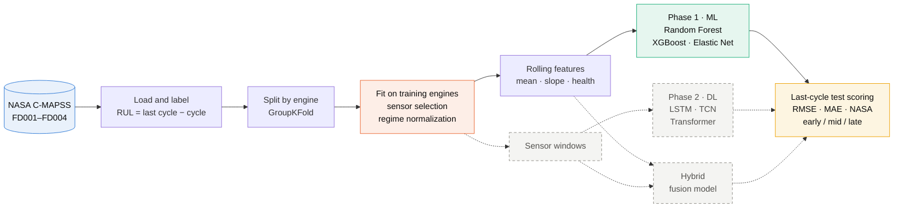
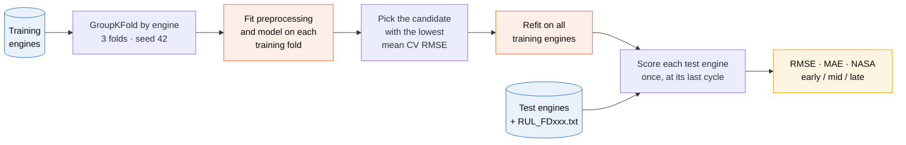
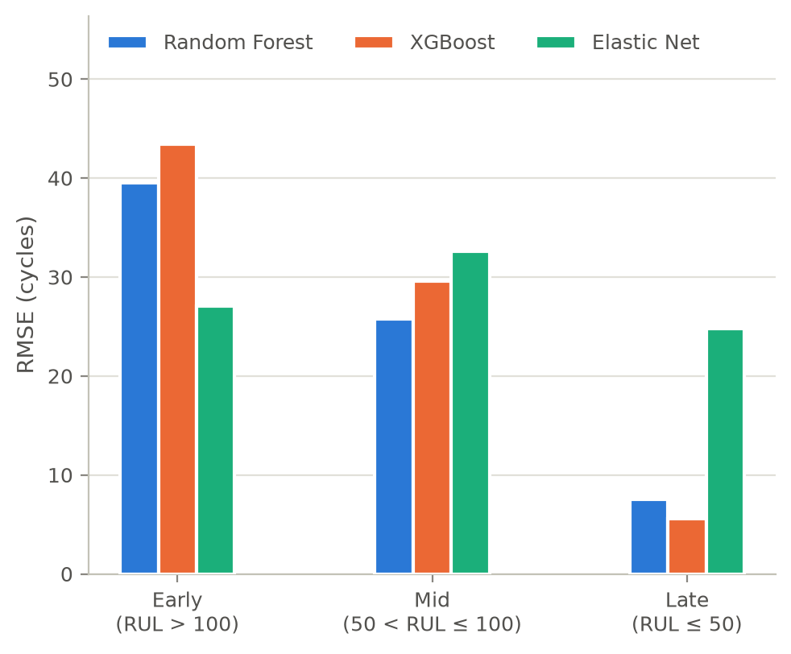

<div align="center">

# cmapss-rul-hybrid

**Remaining Useful Life prediction for turbofan engines on NASA C-MAPSS**

Engineered-feature machine learning (Phase 1) compared with sequence deep learning (Phase 2), plus a hybrid of the two.

[](#results)
[](#approach)
[](pyproject.toml)
[](requirements.txt)
[](requirements.txt)
[](tests/)
[](data/README.md)
[](reports/phase1/main.pdf)

[Phase 1 report](reports/phase1/main.pdf) · [Slides](presentations/phase1.pdf) · [Architecture diagrams](docs/architecture/README.md) · [Contributing](CONTRIBUTING.md)

</div>

## Problem

Each engine in C-MAPSS is a multivariate time series of 3 operating settings and 21 sensors, recorded once per cycle, that runs until failure. The task is to predict how many cycles a test engine has left, given its history up to some point before failure.

Fixed rolling-window features may miss long degradation trajectories and interactions whose timing differs across engines. This project tests whether sequence models close that gap. The full brief is in [`docs/project_brief.md`](docs/project_brief.md).

> [!NOTE]
> **Phase 1 result.** On the 100 official FD001 test engines, all six Phase 1 models (three regressors, each on engineered and on raw features) are within five RMSE cycles of each other (26.15 to 31.08). Near failure (true RUL ≤ 50), engineered features roughly halve the tree models' error: RMSE 7.52 and 5.62, against 13.50 and 14.32 with raw sensors. They overestimate young engines, though. Details are under [Results](#results) and in the [Phase 1 report](reports/phase1/main.pdf).

## Approach



<sub>Solid boxes are built. Grey dashed boxes are planned for Phase 2. Orange marks steps fitted on training engines only. More diagrams are in [`docs/architecture/`](docs/architecture/README.md).</sub>

| Phase | Method | Models | Status |
|---|---|---|---|
| 1: ML | Engineered features: cycle, rolling mean/slope, operating regime, sensor health | Random Forest, XGBoost, Elastic Net | Complete |
| 2: DL | Fixed-length sensor windows | LSTM, Temporal CNN, Transformer encoder | Planned |
| 2: Hybrid | Sequence encoder + engineered-feature branch, fused into one regression head | Fusion model | Planned |

### Evaluation protocol

**Fair comparison.** All models share the same engine-level splits (by `unit` id, never by row) and the same metrics: RMSE and MAE on RUL, NASA score, and error by degradation stage (early / mid / late).



The test engines are used once, after model selection. Diagram 3 in [`docs/architecture/`](docs/architecture/README.md#3-evaluation-protocol) has the full protocol.

### Fold-safe preprocessing

Operating-regime normalization uses `rul.features.regimes.RegimeNormalizer`. Fit it on each training fold, then reuse that fitted object for validation and test data:

```python
from rul.features.regimes import RegimeNormalizer

normalizer = RegimeNormalizer(n_regimes=6, random_state=42)  # FD002 / FD004
train_scaled = normalizer.fit(train_fold).transform(train_fold)
valid_scaled = normalizer.transform(validation_fold)
test_scaled = normalizer.transform(test)
```

Use `n_regimes=1` for FD001 / FD003. The transform preserves metadata columns, replaces the 21 sensor columns with per-regime z-scores, and adds a `regime` column. Never fit it on validation or test rows.

Select sensors separately from the **raw training fold**, before regime normalization. Apply the resulting list to normalized train, validation, and test rows:

```python
from rul.features.cleaning import select_sensors

kept_sensors = select_sensors(train_fold)
train_features = train_scaled[kept_sensors]
valid_features = valid_scaled[kept_sensors]
test_features = test_scaled[kept_sensors]
```

The default rule drops exactly constant training sensors; an optional `min_relative_std` cutoff can also remove nearly flat signals. Relative standard deviation is `std(ddof=0) / max(abs(mean), 1)` on **raw training rows**. Choose any nonzero cutoff using training data only, then reuse the returned sensor list for validation and test. Do not estimate relative variability after z-score normalization, which gives varying sensors roughly unit standard deviation. The [EDA notebook](notebooks/phase1/01_eda.ipynb) found six constant sensors in pooled FD001 training data (`s_1`, `s_5`, `s_10`, `s_16`, `s_18`, `s_19`) and five in FD003 (`s_1`, `s_5`, `s_16`, `s_18`, `s_19`); FD002/FD004 had none when pooled across regimes. Its near-constant candidates are exploratory, so the default rule does not remove them automatically.

## Dataset

NASA C-MAPSS Turbofan Engine Degradation Simulation (Saxena et al., 2008). FD001 is the primary subset; FD002–FD004 are extensions.

| Subset | Train engines | Test engines | Operating conditions | Fault modes |
|---|---:|---:|---:|---|
| **FD001** (primary) | 100 | 100 | 1 | HPC degradation |
| FD002 | 260 | 259 | 6 | HPC degradation |
| FD003 | 100 | 100 | 1 | HPC and fan degradation |
| FD004 | 249 | 248 | 6 | HPC and fan degradation |

The raw data is not committed. Download instructions are under Setup.

## Results

FD001 official test set: 100 engines, each scored once at its last recorded cycle against `RUL_FD001.txt`, with the uncapped RUL target. Lower is better. Phase 2 rows are filled in as experiments complete.

| Model | RMSE | MAE | NASA score |
|---|---|---|---|
| Random Forest | 27.55 | 17.67 | 145,410 |
| XGBoost | 30.50 | 19.82 | 61,202 |
| Elastic Net | 28.39 | 23.57 | 7,777 |
| LSTM | – | – | – |
| Temporal CNN | – | – | – |
| Transformer | – | – | – |
| Hybrid | – | – | – |

Phase 1 rows use the engineered features, with hyperparameters chosen by engine-grouped cross-validation on the training engines only. The NASA score adds one exponential penalty per engine, so a single badly late prediction can dominate it: one test engine accounts for 92% of Random Forest's score. With raw sensor inputs instead, RMSE is 26.15 (Random Forest), 26.84 (XGBoost) and 31.08 (Elastic Net). Stage-wise errors, figures and per-engine predictions are in [`04_ml_results.ipynb`](notebooks/phase1/04_ml_results.ipynb) and [`results/metrics/`](results/metrics/). The full write-up is the [Phase 1 report](reports/phase1/main.pdf), and the slides are in [`presentations/phase1.pdf`](presentations/phase1.pdf).

<p align="center">
  
</p>
<p align="center"><sub>FD001 test RMSE by degradation stage, engineered features. The tree models are most accurate near failure and least accurate on young engines.</sub></p>

## Setup & reproduce

Use Python **3.10 or newer**. Clone `dev`, which contains the current Phase 1
notebooks, then create and activate a virtual environment:

```sh
git clone --branch dev https://github.com/vks-g/cmapss-rul-hybrid.git
cd cmapss-rul-hybrid
python3 -m venv .venv
source .venv/bin/activate
```

On Windows, use `python -m venv .venv`, then activate with
`.venv\Scripts\activate` in Command Prompt or `.venv\Scripts\Activate.ps1`
in PowerShell instead of the `source` command.

Install dependencies and the local package, then download the dataset:

```sh
pip install -r requirements.txt && pip install -e .
python scripts/download_data.py
```

In Windows PowerShell 5.1, run the two `pip install` commands separately,
continuing only after the first succeeds (`&&` requires PowerShell 7 or newer).

The editable install makes `import rul` work in notebooks and tests.
Data is saved to `data/raw/CMAPSSData/`. If all 12 dataset files already exist,
the download is skipped. See [`data/README.md`](data/README.md) for the source,
files, and 26-column format.

Run the tests (all should pass after downloading the data), then open JupyterLab:

```sh
pytest
jupyter lab notebooks/phase1/
```

Use the virtual environment's Python kernel and **Restart Kernel and Run All
Cells** in each Phase 1 notebook, in this order:

1. [`01_eda.ipynb`](notebooks/phase1/01_eda.ipynb)
2. [`02_feature_engineering.ipynb`](notebooks/phase1/02_feature_engineering.ipynb)
   — writes feature files to `data/processed/`.
3. [`03_ml_models.ipynb`](notebooks/phase1/03_ml_models.ipynb) — about 8 minutes.
4. [`04_ml_results.ipynb`](notebooks/phase1/04_ml_results.ipynb) — about 4 minutes;
   writes metrics to `results/metrics/` and figures to `results/figures/`.

Runtimes depend on your hardware.

Each step's inputs and outputs are drawn in the [artifact flow diagram](docs/architecture/README.md#6-artifact-flow).

## Repository structure

```
├── configs/              tuned baseline parameters (ml_baseline.yaml)
├── data/                 README.md only; raw/ and processed/ are gitignored
├── docs/
│   ├── architecture/     system, package, protocol and model diagrams
│   ├── project_brief.md  the project brief
│   └── *.md              notes on rolling features and the ML runs
├── notebooks/
│   ├── phase1/           01 EDA → 02 features → 03 ML models → 04 official results
│   └── phase2/           sequence models, ablations, hybrid (planned)
├── presentations/        phase slide decks
├── reports/phase1/       IEEE LaTeX report: main.tex, sections/, refs.bib, main.pdf
├── results/
│   ├── figures/          EDA and test-set figures
│   └── metrics/          test metrics (JSON) and per-engine predictions (CSV)
├── scripts/              data download, capped-target ablation
├── src/rul/              shared Python package
│   ├── data/             loading, RUL labels, engine-level splits
│   ├── features/         sensor selection, regimes, rolling features, feature matrices
│   ├── models/           ML baselines, fold-fitted comparison pipelines
│   ├── training/         shared PyTorch training loop (Phase 2)
│   └── evaluation/       metrics, official test scoring, plots
└── tests/                pytest suite for the package and scripts
```

## Team

| | Member | GitHub ID |
|:---:|---|---|
|  | **Gokul VKS** (team lead) | [@vks-g](https://github.com/vks-g) |
|  | **Milind Bansal** | [@MilindDevX](https://github.com/MilindDevX) |
|  | **Isha Tomar** | [@Bytebard089](https://github.com/Bytebard089) |
|  | **Yashi Agrawal** | [@11yashiagrawal](https://github.com/11yashiagrawal) |
|  | **Mohammad Affan Anas** | [@affan80](https://github.com/affan80) |

Who built what in Phase 1 is listed in the report's Author Contributions section and is visible in each file's commit history.

## Contributing

Branches, commit messages and review rules are in [`CONTRIBUTING.md`](CONTRIBUTING.md). The branching model is drawn in [`docs/architecture/`](docs/architecture/README.md#9-git-workflow).

## References

- A. Saxena, K. Goebel, D. Simon, and N. Eklund, "Damage Propagation Modeling for Aircraft Engine Run-to-Failure Simulation," *PHM08*, 2008.
- S. Hochreiter and J. Schmidhuber, "Long Short-Term Memory," *Neural Computation*, 1997.
