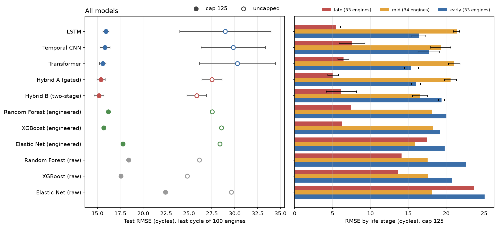

<div align="center">

# cmapss-rul-hybrid

**Remaining Useful Life prediction for turbofan engines on NASA C-MAPSS**

Engineered-feature machine learning (Phase 1) compared with sequence deep learning (Phase 2), plus a hybrid of the two.

[](#results)
[](#results)
[](pyproject.toml)
[](requirements.txt)
[](requirements.txt)
[](requirements.txt)
[](tests/)
[](data/README.md)
[](reports/phase1/main.pdf)

[Phase 1 report](reports/phase1/main.pdf) · [Phase 2 report sources](reports/phase2/README.md) · [Final comparison](notebooks/phase2/15_final_comparison.ipynb) · [Slides](presentations/phase1.pdf) · [Architecture diagrams](docs/architecture/README.md) · [Contributing](CONTRIBUTING.md)

</div>

## Problem

Each engine in C-MAPSS is a multivariate time series of 3 operating settings and 21 sensors, recorded once per cycle, that runs until failure. The task is to predict how many cycles a test engine has left, given its history up to some point before failure.

Fixed rolling-window features may miss long degradation trajectories and interactions whose timing differs across engines. This project tests whether sequence models close that gap. The full brief is in [`docs/project_brief.md`](docs/project_brief.md).

> [!NOTE]
> **Phase 2 result.** With training RUL capped at 125, the Transformer scores 15.60 ± 0.35 RMSE cycles and engineered-feature XGBoost scores 15.71 on the 100 official FD001 test engines. Hybrid B scores 15.18 ± 0.55, but the predefined paired comparisons do not establish an improvement over its feature branch. See [Results](#results), the [final comparison](notebooks/phase2/15_final_comparison.ipynb), and the [uncertainty analysis](notebooks/phase2/13_validation.ipynb).

## Approach

<p align="center">
  <a href="docs/architecture/README.md#1-system-overview"></a>
</p>

<sub>Orange marks steps fitted on training engines only. All nine diagrams, including the package structure and both implemented hybrid models, are in [`docs/architecture/`](docs/architecture/README.md).</sub>

| Phase | Method | Models | Status |
|---|---|---|---|
| 1: ML | Engineered features: cycle, rolling mean/slope, operating regime, sensor health | Random Forest, XGBoost, Elastic Net | Complete |
| 2: DL | 30-cycle sensor windows within each engine | LSTM, Temporal CNN, Transformer encoder | Complete |
| 2: Hybrid | Sequence embeddings + engineered features | A: gated fusion; B: cross-fitted LSTM embeddings + XGBoost | Complete |

### Evaluation protocol

**Fair comparison.** All models share the same engine-level splits (by `unit` id, never by row) and the same metrics: RMSE and MAE on RUL, NASA score, and error by degradation stage (early / mid / late).

<p align="center">
  <a href="docs/architecture/README.md#3-evaluation-protocol"></a>
</p>

Phase 2 caps training labels at **125 cycles**, selected on training engines in [notebook 05](notebooks/phase2/05_rul_cap.ipynb). Tuning uses held-out training cycles with true RUL ≤ 130; preprocessing is fitted within each training fold. Early stopping holds out whole engines inside that fold. Networks refit on all training engines for the median best epoch across folds. The official test runs once after the model freeze, and always uses **true, uncapped RUL** for scoring. Uncapped training runs are reported alongside capped ones.

### Fold-safe preprocessing

Operating-regime normalization uses `rul.features.regimes.RegimeNormalizer`. Fit it on each training fold, then reuse that fitted object for validation and test data:

```python
from rul.features.regimes import RegimeNormalizer

normalizer = RegimeNormalizer(n_regimes=6, random_state=42)  # FD002 / FD004
train_scaled = normalizer.fit(train_fold).transform(train_fold)
valid_scaled = normalizer.transform(validation_fold)
test_scaled = normalizer.transform(test)
```

Use `n_regimes=1` for FD001 / FD003. The transform preserves metadata columns, replaces the 21 sensor columns with per-regime z-scores, and adds a `regime` column. Never fit it on validation or test rows.

Select sensors from the **raw training fold**, using the training regime labels for multi-regime subsets, before estimating sensor variability. Apply the resulting list to normalized train, validation, and test rows:

```python
from rul.features.cleaning import select_sensors

train_regimes = train_scaled["regime"].to_numpy()
kept_sensors = select_sensors(train_fold, regimes=train_regimes)
train_features = train_scaled[kept_sensors]
valid_features = valid_scaled[kept_sensors]
test_features = test_scaled[kept_sensors]
```

The default rule drops exactly constant training sensors; an optional `min_relative_std` cutoff can also remove nearly flat signals. Relative standard deviation is `std(ddof=0) / max(abs(mean), 1)` on **raw training rows**, within each regime when regime labels are supplied. A sensor is kept if it varies within at least one training regime. Choose any nonzero cutoff using training data only, then reuse the returned sensor list for validation and test. Do not estimate relative variability after z-score normalization, which gives varying sensors roughly unit standard deviation. The [EDA notebook](notebooks/phase1/01_eda.ipynb) found six constant sensors in pooled FD001 training data (`s_1`, `s_5`, `s_10`, `s_16`, `s_18`, `s_19`) and five in FD003 (`s_1`, `s_5`, `s_16`, `s_18`, `s_19`); FD002/FD004 had none when pooled across regimes. The [Phase 2 multi-regime study](notebooks/phase2/12_multi_regime.ipynb) instead drops four sensors that are flat within every regime, keeping 17. Its near-constant candidates are exploratory, so the default rule does not remove them automatically.

## Dataset

NASA C-MAPSS Turbofan Engine Degradation Simulation (Saxena et al., 2008). FD001 is the primary subset; FD002–FD004 are extensions.

| Subset | Train engines | Test engines | Operating conditions | Fault modes |
|---|---:|---:|---:|---|
| **FD001** (primary) | 100 | 100 | 1 | HPC degradation |
| FD002 | 260 | 259 | 6 | HPC degradation |
| FD003 | 100 | 100 | 1 | HPC and fan degradation |
| FD004 | 249 | 248 | 6 | HPC and fan degradation |

The raw data is not committed. Download instructions are under Setup.

## Results

FD001 official test: **100 engines**, one prediction at each engine’s last recorded cycle, scored against true, uncapped `RUL_FD001.txt`. Lower is better. Each cell shows **cap-125 training / uncapped training**. Sequence and hybrid results are mean ± sample standard deviation over seeds 42–46; ML baselines use seed 42 once.

| Model | RMSE (cap / uncapped) | MAE (cap / uncapped) | NASA score (cap / uncapped) |
|---|---:|---:|---:|
| LSTM | 15.95 ± 0.33 / 28.97 ± 4.98 | 11.96 ± 0.29 / 19.43 ± 2.52 | 498.82 ± 38.51 / 2,484,887.22 ± 5,356,667.40 |
| Temporal CNN | 15.83 ± 0.55 / 29.85 ± 3.52 | 12.10 ± 0.55 / 21.51 ± 2.88 | 413.95 ± 65.81 / 88,118.04 ± 121,234.68 |
| Transformer | 15.60 ± 0.35 / 30.30 ± 4.15 | 11.91 ± 0.54 / 22.47 ± 3.46 | 442.61 ± 48.55 / 24,119.29 ± 14,855.19 |
| Hybrid A (gated) | 15.40 ± 0.46 / 27.52 ± 1.10 | 11.89 ± 0.55 / 19.75 ± 1.02 | 487.67 ± 116.23 / 88,397.85 ± 86,048.20 |
| Hybrid B (two-stage) | 15.18 ± 0.55 / 25.86 ± 1.07 | 11.28 ± 0.79 / 17.71 ± 0.62 | 355.91 ± 21.84 / 11,823.45 ± 7,028.77 |
| Random Forest (engineered) | 16.21 / 27.55 | 11.95 / 17.67 | 411.67 / 145,409.77 |
| XGBoost (engineered) | 15.71 / 28.56 | 11.59 / 18.96 | 388.52 / 52,991.98 |
| Elastic Net (engineered) | 17.80 / 28.39 | 14.83 / 23.57 | 481.43 / 7,776.72 |
| Random Forest (raw) | 18.42 / 26.15 | 13.75 / 19.22 | 578.24 / 8,414.50 |
| XGBoost (raw) | 17.58 / 24.83 | 12.78 / 18.09 | 574.88 / 5,124.98 |
| Elastic Net (raw) | 22.44 / 29.64 | 17.76 / 24.44 | 1,268.88 / 6,239.14 |

Values are rounded from the full-precision saved metrics. Summary: [`fd001_final_comparison.csv`](results/metrics/fd001_final_comparison.csv), produced by [notebook 15](notebooks/phase2/15_final_comparison.ipynb) at model freeze `fff9e06`. The [saved metrics](results/metrics/fd001_final_test.json) and [per-engine predictions](results/metrics/fd001_final_test_predictions.csv) record all network seeds; [ML metrics](results/metrics/fd001_ml_capped_test.json) and [ML predictions](results/metrics/fd001_ml_capped_test_predictions.csv) record both feature sets. These final ML runs use the Phase 2 selection rule and expanded XGBoost grid; the historical Phase 1 numbers remain in the [Phase 1 report](reports/phase1/main.pdf).

**Interpretation.** Capping the training target makes a larger difference than choosing among the leading model families. The [validation notebook](notebooks/phase2/13_validation.ipynb) finds no clear overall difference for Transformer versus engineered XGBoost, Hybrid A versus LSTM, or Hybrid B versus engineered XGBoost. The small differences in test means do not establish a winning model. Stage-wise RMSE (late ≤ 50, mid ≤ 100, early > 100) is in the comparison CSV; bootstrap intervals and paired tests are in the validation notebook.

<p align="center">
  
</p>

The [multi-regime study](notebooks/phase2/12_multi_regime.ipynb) extends the LSTM and Hybrid A to FD002 and FD004. The [Phase 2 report](reports/phase2/README.md) also covers regularization, ablations and interpretability.

## Setup & reproduce

Use Python **3.10 or newer**. Clone `dev`, which contains both phases, then create and activate a virtual environment:

```sh
git clone --branch dev https://github.com/vks-g/cmapss-rul-hybrid.git
cd cmapss-rul-hybrid
python3 -m venv .venv
source .venv/bin/activate
```

On Windows, use `python -m venv .venv`, then activate with
`.venv\Scripts\activate` in Command Prompt or `.venv\Scripts\Activate.ps1`
in PowerShell instead of the `source` command.

Install dependencies and the local package, then download the dataset:

```sh
pip install -r requirements.txt && pip install -e .
python scripts/download_data.py
```

In Windows PowerShell 5.1, run the two `pip install` commands separately,
continuing only after the first succeeds (`&&` requires PowerShell 7 or newer).

The editable install makes `import rul` work in notebooks and tests.

The requirements include PyTorch (`torch>=2.6`) for the Phase 2 sequence models.
CPU is enough for FD001; a GPU is optional. For a GPU-specific build, follow the
[official PyTorch installation instructions](https://pytorch.org/get-started/locally/).
Verify the installation in the activated virtual environment:

```sh
python -c "import torch, rul"
```

Data is saved to `data/raw/CMAPSSData/`. If all 12 dataset files already exist,
the download is skipped. See [`data/README.md`](data/README.md) for the source,
files, and 26-column format.

Run the tests (all should pass after downloading the data), then open JupyterLab:

```sh
pytest
jupyter lab notebooks/phase1/
```

Use the virtual environment's Python kernel and **Restart Kernel and Run All
Cells** in each Phase 1 notebook, in this order:

1. [`01_eda.ipynb`](notebooks/phase1/01_eda.ipynb)
2. [`02_feature_engineering.ipynb`](notebooks/phase1/02_feature_engineering.ipynb)
   — writes feature files to `data/processed/`.
3. [`03_ml_models.ipynb`](notebooks/phase1/03_ml_models.ipynb) — about 8 minutes.
4. [`04_ml_results.ipynb`](notebooks/phase1/04_ml_results.ipynb) — about 4 minutes;
   writes metrics to `results/metrics/` and figures to `results/figures/`.

Runtimes depend on your hardware.

Each step's inputs and outputs are drawn in the [artifact flow diagram](docs/architecture/README.md#6-artifact-flow).

### Phase 2 reproduction

Run from the repository root with the environment above active. The configs inherit
`configs/dl_base.yaml`: cap 125, window 30, three engine-grouped folds, CPU and
seed 42. These commands run training-engine cross-validation only; they do not
score the official test. `--refit` additionally saves a checkpoint under the
gitignored `results/models/`.

```sh
python scripts/train_dl.py --config configs/lstm.yaml
python scripts/train_dl.py --config configs/tcn.yaml
python scripts/train_dl.py --config configs/transformer.yaml
python scripts/train_dl.py --config configs/hybrid_gated.yaml
python scripts/train_dl.py --config configs/hybrid_two_stage.yaml
python scripts/train_dl.py --config configs/lstm.yaml --set target.cap=null --name lstm_uncapped
python scripts/run_ml_baselines.py
jupyter lab notebooks/phase2/
```

For uncapped runs of the other models, use the same `--set target.cap=null` and
`--name <model>_uncapped` options. Use a separate `--metrics-dir` when experimenting
to preserve the committed tuning results required by the freeze check.

Phase 2 notebooks run in numeric order: [05 target cap](notebooks/phase2/05_rul_cap.ipynb),
[06 LSTM](notebooks/phase2/06_lstm.ipynb), [07 TCN](notebooks/phase2/07_tcn.ipynb),
[08 Transformer](notebooks/phase2/08_transformer.ipynb), [09 hybrids](notebooks/phase2/09_hybrid.ipynb),
[10 regularization](notebooks/phase2/10_regularization.ipynb),
[11 ablations](notebooks/phase2/11_ablations.ipynb),
[12 multi-regime](notebooks/phase2/12_multi_regime.ipynb),
[13 validation](notebooks/phase2/13_validation.ipynb),
[14 interpretability](notebooks/phase2/14_interpretability.ipynb), and
[15 final comparison](notebooks/phase2/15_final_comparison.ipynb).
Notebook 15 reloads the committed final predictions instead of retraining or
rescoring when they exist; it checks the frozen code and configs first. Validation
in notebook 13 consumes those saved predictions, so a fresh run without them must
produce notebook 15's final artifacts before notebook 13. Preserve the frozen
settings and the saved official results when reproducing the analysis.

## Repository structure

```
├── configs/              ML parameters and shared / model-specific Phase 2 YAML configs
├── data/                 README.md only; raw/ and processed/ are gitignored
├── docs/
│   ├── architecture/     system, package, protocol and model diagrams
│   ├── project_brief.md  the project brief
│   └── *.md              notes on rolling features and the ML runs
├── notebooks/
│   ├── phase1/           01 EDA → 02 features → 03 ML models → 04 official results
│   └── phase2/           05 cap → models / hybrids → studies → 15 final comparison
├── presentations/        phase slide decks
├── reports/              phase1/ report and PDF; phase2/ sections, tables and refs
├── results/
│   ├── figures/          EDA and test-set figures
│   └── metrics/          test metrics (JSON) and per-engine predictions (CSV)
├── scripts/              data download, CV training, cap / ablation runs, report tables
├── src/rul/              shared Python package
│   ├── data/             loading, RUL labels, engine-level splits
│   ├── features/         sensor selection, regimes, rolling features, feature matrices
│   ├── models/           ML pipelines, LSTM, TCN, Transformer, gated and two-stage hybrids
│   ├── training/         config / inputs, engine-safe CV, early stopping and refit
│   └── evaluation/       metrics, official test scoring, plots
└── tests/                pytest suite for the package and scripts
```

## Team

| | Member | GitHub ID |
|:---:|---|---|
|  | **Gokul VKS** (team lead) | [@vks-g](https://github.com/vks-g) |
|  | **Milind Bansal** | [@MilindDevX](https://github.com/MilindDevX) |
|  | **Isha Tomar** | [@Bytebard089](https://github.com/Bytebard089) |
|  | **Yashi Agrawal** | [@11yashiagrawal](https://github.com/11yashiagrawal) |
|  | **Mohammad Affan Anas** | [@affan80](https://github.com/affan80) |

Contributions are recorded in each phase’s report and in the file commit history.

## Contributing

Branches, commit messages and review rules are in [`CONTRIBUTING.md`](CONTRIBUTING.md). The branching model is drawn in [`docs/architecture/`](docs/architecture/README.md#9-git-workflow).

## References

- A. Saxena, K. Goebel, D. Simon, and N. Eklund, "Damage Propagation Modeling for Aircraft Engine Run-to-Failure Simulation," *PHM08*, 2008.
- S. Hochreiter and J. Schmidhuber, "Long Short-Term Memory," *Neural Computation*, 1997.
