# Architecture diagrams

Diagrams of how the project is built: the data flow, the `rul` package, the evaluation protocol, the Phase 1 models, and the planned Phase 2 models. Each diagram is a Mermaid source file in [`src/`](src/), rendered to [`svg/`](svg/) for Markdown and to [`png/`](png/) for slides and the LaTeX reports.

| # | Diagram | Shows |
|---|---|---|
| 1 | [System overview](#1-system-overview) | End-to-end flow from the NASA files to the scored results |
| 2 | [Package modules](#2-package-modules) | Which `rul` modules import which |
| 3 | [Evaluation protocol](#3-evaluation-protocol) | Leakage-safe model selection and the one-time official test |
| 4 | [Feature pipeline](#4-feature-pipeline) | How 155 engineered predictors are built from raw readings |
| 5 | [Phase 1 models](#5-phase-1-models) | The scikit-learn pipelines and their tuning grids |
| 6 | [Artifact flow](#6-artifact-flow) | Which scripts and notebooks read and write which files |
| 7 | [Sequence models](#7-sequence-models-planned) | Phase 2 LSTM, Temporal CNN and Transformer (planned) |
| 8 | [Hybrid model](#8-hybrid-model-planned) | Phase 2 fusion of sequence and engineered features (planned) |
| 9 | [Git workflow](#9-git-workflow) | Branches, reviewed pull requests and milestone tags |

**Color key.** Blue: data. Orange: fitted on training engines only, which is where leakage could enter. Green: models. Amber: outputs. Gray with a dashed border: planned for Phase 2 and not built yet. In the package diagram, color marks the subpackage instead.

## 1. System overview



Raw C-MAPSS files are loaded and labeled, split by engine, and preprocessed with statistics fitted on the training engines only. Phase 1 models use rolling features. Phase 2 models will use sensor windows, and the hybrid will use both. Every model goes through the same last-cycle test scoring and metrics.

## 2. Package modules



An arrow means "imports". `rul.data.load` holds the column names used everywhere. `models/experiment.py` assembles the fold-fitted pipelines from the feature modules. `evaluation/official.py` scores test engines with the shared metrics. `evaluation/plots.py` has no internal dependencies. The Phase 2 modules (`features/windows.py`, `training/trainer.py`, the sequence and hybrid models) are not built yet.

## 3. Evaluation protocol



All model selection uses the training engines only, through engine-grouped folds, with every preprocessing step refitted inside each fold. The test set is touched once, after selection. Each test engine is scored at its last recorded cycle against `RUL_FD001.txt`. The same protocol applies to the Phase 2 models.

## 4. Feature pipeline



`EngineFeatures` in [`src/rul/models/experiment.py`](../../src/rul/models/experiment.py). Sensor selection and the regime normalizer are fitted on training engines. Rolling features use only past cycles of the same engine, so they carry no fitted state. Counts are for FD001.

## 5. Phase 1 models



Each model is a scikit-learn `Pipeline` of `EngineFeatures` and a regressor, tuned with `GridSearchCV` over the engine-grouped folds. The grids are `COMPARISON_GRIDS` in `src/rul/models/experiment.py`.

## 6. Artifact flow



Run the notebooks in order (see [Setup & reproduce](../../README.md#setup--reproduce)). `data/` is gitignored. Metrics and figures under `results/` are committed, and the report and slides are built from them.

## 7. Sequence models (planned)



The Phase 2 design: windows built inside engine boundaries, one encoder per model, and a shared training loop. Window length and the encoder settings will be tuned in Phase 2.

## 8. Hybrid model (planned)



The fusion model targets the gap in the [project brief](../project_brief.md). Fixed rolling features may miss long degradation trajectories, so a sequence branch learns them from the raw window. The engineered-feature branch keeps what Phase 1 showed works near failure.

## 9. Git workflow



Topic branches are merged into `dev` through reviewed pull requests, as merge commits so each author's commits are kept. `dev` is merged into `main` at the end of each phase, and the merge is tagged. The rules are in [`CONTRIBUTING.md`](../../CONTRIBUTING.md).

## Editing a diagram

Edit the `.mmd` file in `src/`, then re-render both outputs from this folder:

```sh
for f in src/*.mmd; do
  n=$(basename "$f" .mmd)
  npx -y @mermaid-js/mermaid-cli@11.17.0 -c mermaid.config.json -b white -i "$f" -o "svg/$n.svg"
  npx -y @mermaid-js/mermaid-cli@11.17.0 -c mermaid.config.json -b white -s 2 -i "$f" -o "png/$n.png"
done
```

The first run downloads a headless Chromium. Commit the source and both renders together, so they stay in sync.
